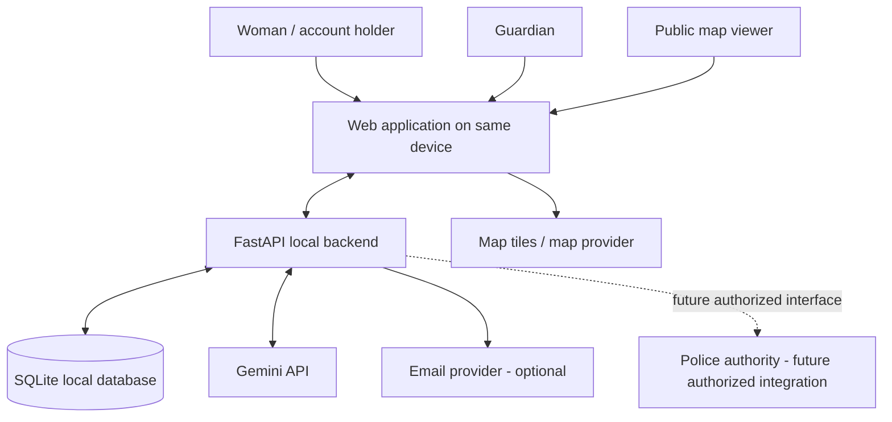
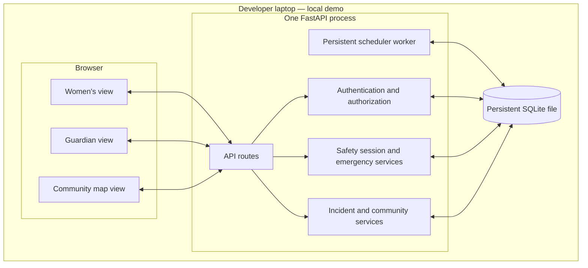
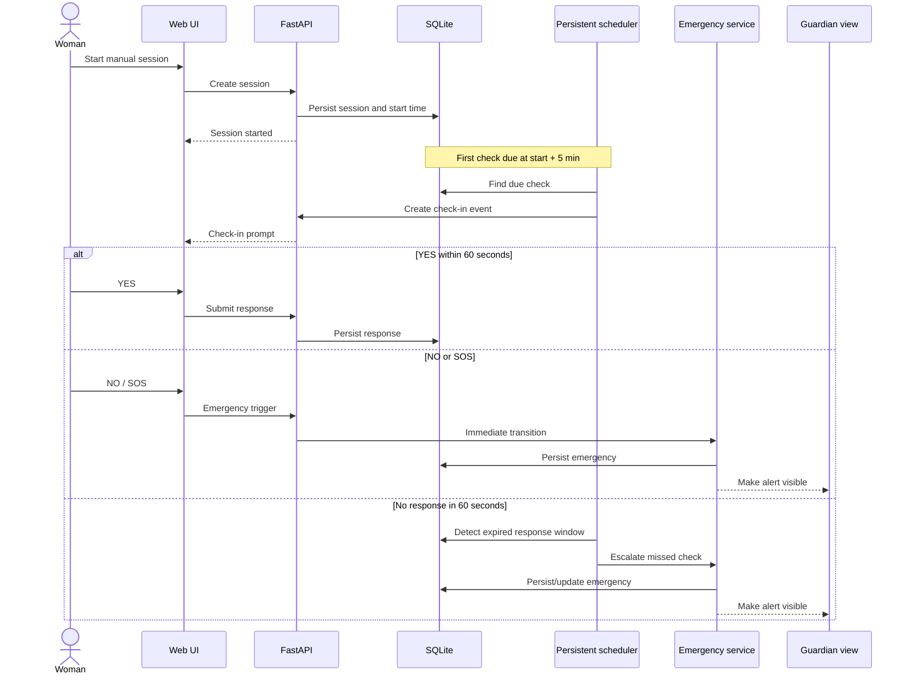

# AMANAH AI — System Architecture

**Status:** Proposed architecture for review — not approved  
**Version:** 0.1  
**Architecture direction:** Local-first modular monolith  
**Related:** [PRD.md](PRD.md), [TRD.md](TRD.md), [appFlow.md](appFlow.md), [database.md](database.md)

## 1. Architecture summary

The confirmed constraints are FastAPI backend preference, SQLite database, local-machine hosting, same-device guardian demonstration, persistent scheduling, and local-first future direction.

A **modular monolith** is proposed: one backend application organized into logical modules, one SQLite database, and one frontend application with role-specific views. Microservices are not justified for a three-hour prototype.

The frontend framework, ORM, scheduler implementation, authentication transport, map library, and notification provider remain unapproved.

## 2. System context



The browser roles are distinct authenticated views. Same-device demonstration does not mean that the guardian can bypass authorization.

## 3. Container / deployment view



**Important:** A browser URL using `localhost` is reachable only from that same device. A remote guardian cannot access the local backend through the same URL. LAN/tunnel/cloud access is not approved.

## 4. Proposed backend modules

| Module | Responsibility | Main dependencies |
|---|---|---|
| `auth` | Account authentication and role checks | User persistence, password hashing |
| `guardians` | Guardian relationship and access grants | Users, consent/authorization records |
| `sessions` | Manual session lifecycle and schedule data | Users, scheduler |
| `scheduler` | Due check detection, timeout processing, restart recovery | Sessions, checks, emergency service |
| `emergencies` | SOS, NO, missed-check escalation, cancellation | Sessions, checks, notifications |
| `locations` | Permission-aware location updates and access filtering | User, session, guardian grants |
| `notifications` | Queue and attempt status | Emergency service, optional provider |
| `incidents` | Personal incident reports and user approval | User, consent, Gemini adapter |
| `community` | Publicly approved anonymized reports | Incidents, consent, map presentation |
| `police_assistance` | Trusted contact information / future integration boundary | Verified external source |

These are logical boundaries, not a requirement to create a separate process or microservice for each.

## 5. Safety scheduler and emergency sequence



The schedule is anchored to session start: first check at +5 minutes, then every 3 minutes. Each response window is 60 seconds. NO/SOS are immediate. Repeated missed checks update an active emergency and cause another notification attempt.

### 5.1 Persistence and recovery

The scheduler must not rely only on a Python sleep loop, browser timer, or FastAPI `BackgroundTasks`.

Proposed database-driven approach:
1. Persist session start and calculated check deadlines.
2. Persist each check's due time, response deadline, and processing state.
3. Periodically query for due/unprocessed events.
4. Process state transitions transactionally.
5. Use a unique event identity or equivalent guard to prevent duplicate processing.
6. On backend startup, reconcile overdue events.
7. Record whether an event was processed and whether a notification was queued/attempted.

This is a recommendation, not an approved implementation choice. The exact behavior for checks that became overdue while the laptop was powered off must be approved. No alert can be transmitted while the machine is off.

## 6. Trust boundaries and authorization

- Browser input is untrusted.
- The FastAPI backend is the trusted enforcement point for ownership and permissions.
- A guardian may access only the account holder's currently authorized emergency information.
- Historical location access is separately user-controlled and revocable.
- Public community data is a minimized, anonymized projection; it must not expose the private incident record.
- Gemini is an external processor and its output is untrusted.
- External notification and map services are dependencies, not trusted sources of authorization.
- Police integration is outside the trusted system boundary until an official, authorized interface is established.

## 7. Error handling and failure modes

| Failure | Expected system behavior |
|---|---|
| Gemini unavailable | Allow manual incident report; do not affect safety engine |
| GPS unavailable | Send/display alert without fresh location, or use timestamped last-known location |
| Internet unavailable | Continue local emergency state processing; queue external notification for later retry |
| Backend stops | No live scheduler processing while stopped; recover persisted overdue work on restart |
| SQLite locked/write error | Report failure, avoid claiming persistence succeeded, log safely |
| Guardian notification fails | Preserve emergency record and notification failure state; escalation policy unresolved |
| User denies location | Continue session without location; communicate limitation |
| Browser suspended/closed | UI/browser location behavior may stop; backend scheduler remains dependent on laptop/backend availability |

## 8. Proposed folder structure

The structure below is a proposal contingent on React + TypeScript, Vite, FastAPI, and SQLAlchemy approval.

```text
amanah-ai/
├── docs/
│   ├── PRD.md
│   ├── TRD.md
│   ├── Architecture.md
│   ├── appFlow.md
│   ├── database.md
│   ├── design.md
│   ├── Rules.md
│   └── phases.md
├── frontend/                 # proposed React application
│   └── src/
│       ├── components/
│       ├── pages/
│       ├── services/
│       ├── hooks/
│       └── styles/
├── backend/
│   └── app/
│       ├── main.py
│       ├── config.py
│       ├── database.py
│       ├── models/
│       ├── schemas/
│       ├── routes/
│       ├── services/
│       ├── security/
│       └── scheduler/
├── data/                     # local persistent data; exclude from Git
├── tests/
├── .env.example
└── README.md
```

Do not create all folders mechanically if the approved stack or actual MVP scope changes.

## 9. Architecture decisions and trade-offs

| Decision | Position | Trade-off |
|---|---|---|
| Modular monolith | Proposed | Simple deployment and integration; modules need clear boundaries |
| SQLite | Confirmed | Easy local setup; limited concurrent writes and single-machine storage |
| Local hosting | Confirmed | Good for demo; not remotely reachable by default |
| Same-device guardian | Confirmed | Demonstrates authorization and alert display, not real remote delivery |
| Persistent scheduler | Confirmed requirement; implementation unresolved | Recovery possible, but no processing while machine is off |
| Database-driven scheduler | Recommended | Transparent and testable; polling interval and recovery semantics need design |
| REST + polling | Proposed | Simple; dashboard updates are not instantaneous |
| React + TypeScript | Proposed | Structured UI; extra setup time |
| SQLAlchemy | Proposed | Easier data access/migration; dependency and model setup overhead |

## 10. Architecture open questions

- Approve or reject modular monolith.
- Approve frontend stack and folder structure.
- Choose authentication mechanism.
- Choose scheduler implementation and downtime recovery policy.
- Decide polling interval / whether WebSockets are needed.
- Decide in-app versus email notification for the demo.
- Decide map provider and public coordinate handling.
- Define database backup and sensitive-data handling.
- Clarify same-device role switching and whether one browser profile is acceptable.
