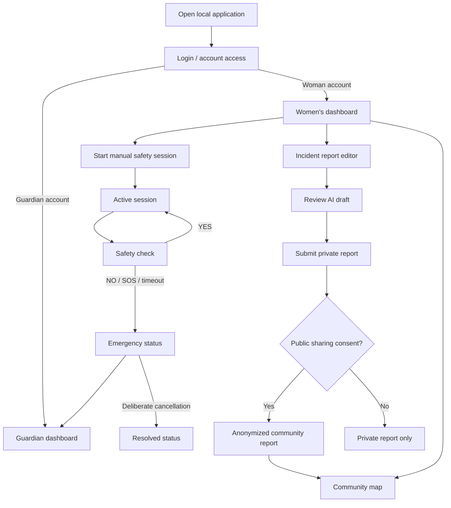
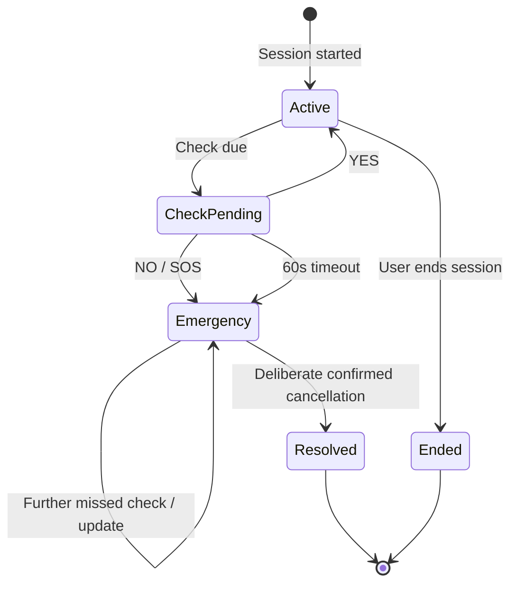

# AMANAH AI — Application and User Flow

**Status:** Draft for review — proposed screens and flows require approval  
**Version:** 0.1  
**Related:** [PRD.md](PRD.md), [Architecture.md](Architecture.md), [design.md](design.md)

## 1. Scope and roles

The hackathon demonstration is local-first and same-device. It has a woman's view, a guardian view, and a community map view. These are proposed screen groupings, not finalized navigation or visual design.

## 2. Proposed screen inventory

| Screen | User | Priority | Purpose |
|---|---|---|---|
| Login / account access | Woman, guardian | P0 | Authenticate demo accounts |
| Women's safety dashboard | Woman | P0 | Start/stop session, view status, access SOS |
| Active session / check-in | Woman | P0 | Respond YES/NO and see session state |
| Emergency status | Woman | P0 | Show active emergency and deliberate cancellation |
| Guardian dashboard | Guardian | P0 | View authorized emergency alert/details |
| Incident report editor | Woman | P1 | Create/edit personal report and review AI draft |
| Community map | Public / signed-in user | P1 | View anonymized approved reports or labelled demo data |
| Guardian management | Woman | P1 | Add/remove guardian; verification process unresolved |
| Police assistance | Woman | Future | Display trusted contacts and calling/navigation options |

## 3. Navigation proposal

## 4. Core flows

### 4.1 Login / account access

**Trigger:** User opens the application and submits credentials.

1. Validate required fields on the client for usability.
2. Send credentials to the backend.
3. Backend verifies the password and determines the persisted role.
4. On success, route the woman to her dashboard or the guardian to the guardian dashboard.
5. On failure, show a generic authentication error without revealing whether an account exists.
6. Loading state disables repeated submission.
7. Logout ends the authenticated session/token and returns to login.

**Unresolved:** JWT versus secure cookie session, registration workflow, password reset, and guardian account invitation/verification.

### 4.2 Start manual safety session

**Trigger:** Woman presses Start Safety Session.

1. Check that she is authenticated and has no conflicting active session, according to a rule still to be approved.
2. Request location permission if location capture is part of the selected flow.
3. If permission is denied or location unavailable, allow the session to continue and show the limitation.
4. Backend creates a manual session and persists the start time.
5. Scheduler records the first check deadline at start + 5 minutes.
6. UI displays active status and next check time if available.
7. If creation fails, show an error and do not display a false active state.

Journey-based session is deferred from the three-hour MVP.

### 4.3 Safety check and response

**Trigger:** Scheduler determines that a check is due.

1. Backend creates/persists the check event.
2. UI displays a check-in prompt.
3. User chooses YES, NO, or SOS.
4. YES persists the response and monitoring continues; the original anchored schedule does not reset.
5. NO triggers emergency processing immediately.
6. SOS triggers emergency processing immediately.
7. If no response arrives within 60 seconds, the scheduler marks the check unconfirmed and triggers guardian escalation.
8. A missed check must never be labelled as proof that the user is in danger.
9. Further missed checks during an active emergency update the existing emergency and cause another notification attempt.

**Failure states:** API unavailable, scheduler stopped, browser suspended, location unavailable, and duplicate response. The UI must not imply that an action was saved if the backend did not confirm persistence.

### 4.4 Emergency and guardian alert

**Trigger:** NO, SOS, or expired response window.

1. Backend validates session ownership and current state.
2. Emergency engine creates or updates the emergency record.
3. Latest available location and timestamp may be attached if available and authorized.
4. Notification service creates an in-app guardian alert for the local demo.
5. Guardian signs into the separate guardian view.
6. Guardian sees the alert and only authorized information.
7. Repeated missed checks update the existing emergency and create another notification attempt.
8. If notification cannot be delivered, preserve the emergency record and show its actual status.

**Important:** The local same-device dashboard is not a remote notification channel.

### 4.5 Deliberate emergency cancellation

**Trigger:** Woman selects Cancel / Resolve Emergency.

1. Show a confirmation step to prevent accidental cancellation.
2. On confirmation, backend validates the user and emergency state.
3. Persist cancellation/resolution time and actor.
4. Update guardian dashboard with the resolution.
5. If an official police integration exists in a future version, send an update only if the authorized channel supports it.
6. Do not claim that an external dispatch has been withdrawn unless confirmed.

**Unresolved:** Exact wording, allowed state transitions, and late YES handling after a guardian alert.

### 4.6 Location handling

- Ask for browser/device permission before accessing location.
- Explain why location is requested.
- If available, associate location with the active session/emergency as allowed.
- If fresh location is unavailable, continue the alert without it or use a timestamped last-known location.
- Do not show precise location to a guardian unless access is authorized.
- Do not expose exact live location in public community reports.
- If permission is denied, the user can still use non-location safety functions.

### 4.7 AI-assisted incident report

**Trigger:** User opens report editor and supplies their own personal account.

1. User enters incident details.
2. User requests AI assistance.
3. Backend sends only necessary information to Gemini.
4. AI returns a proposed structured draft/summary/category/translation.
5. UI clearly labels the output as AI-generated.
6. User edits and reviews it.
7. User explicitly approves before submission.
8. If AI fails, retain the user's manual draft and allow manual submission.
9. AI must not invent evidence, identity, event details, accusations, or decide whether a crime occurred.

### 4.8 Public sharing consent

1. User chooses whether to share the personal incident report publicly.
2. If consent is declined, save the report privately.
3. If consent is granted, create a minimized anonymized public representation.
4. Do not publish identity, exact live location, or identifying narrative details.
5. If user later changes sharing preferences for already published reports, ask whether prior reports should be removed or retained.
6. Until the user answers, temporarily hide prior published reports.

**Unresolved:** Public location precision, publication delay, minimum aggregation threshold, and final retention/deletion policy.

### 4.9 Community map

- Display only public-approved anonymized reports or clearly labelled sample records.
- Make clear that markers represent user-reported concerns, not verified crimes.
- Do not infer an area is safe because it has no reports.
- Provide an empty state when no reports are available.
- Handle map tile/network failure with an explanatory fallback.

### 4.10 Police assistance

Future flow only:
- Display verified police contact details from an authoritative source.
- Provide calling/navigation affordances only when the data is verified.
- Official notification requires an authorized authority/channel and acknowledgment.
- A demo-only simulated event must be labelled as simulated.

## 5. Important state model

This is a conceptual state model. Exact normal session-end and expiry rules remain unresolved. A late YES after escalation is not represented until its policy is decided.

## 6. UI states to support

| State | Required feedback |
|---|---|
| Loading | Clear progress indicator; prevent accidental duplicate actions |
| Empty guardian list | Explain that a guardian must be configured before guardian alerts can be demonstrated |
| Active session | Active indicator, start time, next check information if available |
| Check-in pending | Clear prompt and response choices |
| Emergency active | Clear emergency status, available actions, location freshness |
| Location unavailable | Explain that alerting can proceed without fresh location |
| Notification queued | Say queued, not delivered |
| Notification failed | Show failure status without hiding emergency record |
| AI unavailable | Keep manual report editable |
| No community reports | Empty state; do not imply safety |
| Consent not granted | Keep report private |
| Backend unavailable | Explain that the action was not confirmed/persisted |

## 7. MVP navigation simplification

For the three-hour demo, prioritize:
- Login
- Women's dashboard
- Active session/check-in
- Emergency status
- Guardian dashboard

Incident reporting and community map are P1 and should only be built after the P0 emergency workflow is working.

## 8. Open flow decisions

- Registration and guardian onboarding details.
- Late YES after guardian alert.
- Normal manual session ending and automatic expiration.
- Multiple simultaneous sessions policy.
- Exact guardian details visible in an alert.
- Guardian acknowledgment behavior.
- Guardian count and contact verification.
- Whether community map is accessible without login.
- Public map precision and publication delay.
- Error handling when the local backend is stopped.
