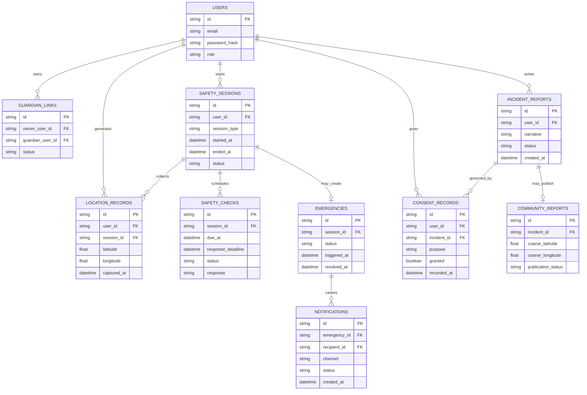

# AMANAH AI — Database Design

**Status:** Proposed logical schema — not approved  
**Version:** 0.1  
**Database preference:** SQLite (confirmed)  
**ORM:** SQLAlchemy (proposed)  
**Related:** [PRD.md](PRD.md), [TRD.md](TRD.md), [Architecture.md](Architecture.md)

## 1. Scope and modeling rules

SQLite is the user's selected database preference. The table design below is a **proposed logical model**, not an approved physical schema. Exact columns, data types, retention, deletion behavior, and indexes require review.

The three-hour MVP should implement only the entities required by its working features. Do not create every proposed table merely because it appears here.

## 2. Proposed entity relationship diagram

The diagram is conceptual. In particular, a guardian may be represented as an existing user or a contact record depending on the approved onboarding design. The exact relationship is unresolved.

## 3. Proposed entities

### 3.1 `users`

Purpose: account identity and authentication.

| Field | Proposed type | Notes |
|---|---|---|
| `id` | UUID/text primary key | Stable identifier |
| `email` | Text | Uniqueness and verification policy unresolved |
| `password_hash` | Text | Never store plaintext password |
| `role` | Text/enum | Woman or guardian for MVP; exact role model requires approval |
| `created_at` | UTC datetime | Account creation time |
| `is_active` | Boolean | Optional account status |

### 3.2 `guardian_links`

Purpose: represent authorization relationship between an account holder and guardian.

| Field | Proposed type | Notes |
|---|---|---|
| `id` | UUID/text primary key | Stable relationship ID |
| `owner_user_id` | FK to users | Account holder |
| `guardian_user_id` | FK to users or contact entity | Depends on onboarding decision |
| `status` | Text/enum | Pending, active, revoked are candidate states |
| `created_at` | UTC datetime | Relationship creation |
| `revoked_at` | UTC datetime nullable | Revocation timestamp |

One guardian is proposed for the hackathon MVP, but the final count is unresolved.

### 3.3 `safety_sessions`

Purpose: record user-initiated safety monitoring sessions.

| Field | Proposed type | Notes |
|---|---|---|
| `id` | UUID/text primary key | Session ID |
| `user_id` | FK to users | Session owner |
| `session_type` | Text/enum | Manual; journey is deferred |
| `started_at` | UTC datetime | Schedule anchor |
| `ended_at` | UTC datetime nullable | End time |
| `status` | Text/enum | Active, ended, expired are candidates; final transitions unresolved |
| `created_at` | UTC datetime | Record creation |

Journey destination/origin/duration fields are not included in the MVP schema because journey sessions are deferred.

### 3.4 `safety_checks`

Purpose: persist scheduled checks and response windows.

| Field | Proposed type | Notes |
|---|---|---|
| `id` | UUID/text primary key | Check ID |
| `session_id` | FK to safety_sessions | Owning session |
| `sequence_number` | Integer | Order within session |
| `due_at` | UTC datetime | Anchored due time |
| `response_deadline` | UTC datetime | Due time + 60 seconds |
| `status` | Text/enum | Scheduled, pending, answered, expired, processed are candidates |
| `response` | Text/enum nullable | YES, NO, SOS, or null |
| `responded_at` | UTC datetime nullable | Response time |
| `processed_at` | UTC datetime nullable | Scheduler processing time |

A unique constraint on `(session_id, sequence_number)` is proposed to prevent duplicate scheduled check records.

### 3.5 `emergencies`

Purpose: persistent emergency state created by NO, SOS, or missed check.

| Field | Proposed type | Notes |
|---|---|---|
| `id` | UUID/text primary key | Emergency ID |
| `session_id` | FK to safety_sessions | Associated session |
| `status` | Text/enum | Active, resolved are candidates |
| `trigger_reason` | Text/enum | NO, SOS, missed check |
| `triggered_at` | UTC datetime | Initial trigger time |
| `last_updated_at` | UTC datetime | Latest update |
| `resolved_at` | UTC datetime nullable | Resolution time |
| `resolution_actor_id` | FK to users nullable | Who confirmed resolution |

The relationship between session and emergency is proposed as at most one active emergency per session. Exact database enforcement and reopening policy are unresolved.

### 3.6 `location_records`

Purpose: timestamped location data, subject to permission and access policy.

| Field | Proposed type | Notes |
|---|---|---|
| `id` | UUID/text primary key | Location record ID |
| `user_id` | FK to users | Data subject |
| `session_id` | FK to safety_sessions nullable | Related session |
| `latitude` | Numeric | Sensitive precise location |
| `longitude` | Numeric | Sensitive precise location |
| `captured_at` | UTC datetime | Freshness timestamp |
| `source` | Text | Device/browser or other source, if known |

Retention, update frequency, precision, and whether location is stored at every check or only on meaningful events are unresolved. Minimize collection.

### 3.7 `notifications`

Purpose: record notification attempts.

| Field | Proposed type | Notes |
|---|---|---|
| `id` | UUID/text primary key | Notification ID |
| `emergency_id` | FK to emergencies | Related emergency |
| `recipient_id` | FK to users/contact entity | Recipient |
| `channel` | Text/enum | In-app, email, SMS, push candidates |
| `status` | Text/enum | Queued, sent, delivered, acknowledged, failed candidates |
| `created_at` | UTC datetime | Creation |
| `attempted_at` | UTC datetime nullable | Last attempt |
| `provider_reference` | Text nullable | External provider ID if available |
| `failure_reason` | Text nullable | Safe, non-sensitive summary |

The provider and channel are not selected. Do not claim delivery based only on a queued record.

### 3.8 `incident_reports`

Purpose: private personal-experience incident report.

| Field | Proposed type | Notes |
|---|---|---|
| `id` | UUID/text primary key | Report ID |
| `user_id` | FK to users | Report author |
| `narrative` | Text | User-supplied account; sensitive |
| `ai_draft` | Text nullable | AI output, if used |
| `category` | Text nullable | User-approved category |
| `status` | Text/enum | Draft, submitted, withdrawn candidates |
| `created_at` | UTC datetime | Creation |
| `updated_at` | UTC datetime | Last update |

AI output must remain a draft until reviewed and approved by the user.

### 3.9 `consent_records`

Purpose: retain evidence of consent decisions.

| Field | Proposed type | Notes |
|---|---|---|
| `id` | UUID/text primary key | Consent record ID |
| `user_id` | FK to users | Person giving consent |
| `incident_id` | FK to incident_reports | Related report |
| `purpose` | Text | Public community sharing or other defined purpose |
| `granted` | Boolean | Explicit decision |
| `recorded_at` | UTC datetime | Decision time |
| `revoked_at` | UTC datetime nullable | Revocation/change time |

Consent wording, versioning, and prior-publication removal behavior need approval.

### 3.10 `community_reports`

Purpose: minimized public representation derived from a consented personal report.

| Field | Proposed type | Notes |
|---|---|---|
| `id` | UUID/text primary key | Public record ID |
| `incident_id` | FK to incident_reports | Source report |
| `coarse_latitude` | Numeric nullable | Only after precision policy approval |
| `coarse_longitude` | Numeric nullable | Only after precision policy approval |
| `public_category` | Text nullable | Approved non-identifying category |
| `published_at` | UTC datetime nullable | Publication timestamp |
| `publication_status` | Text/enum | Hidden, pending, published, removed candidates |

Exact location coarsening, delay, aggregation threshold, and public fields are unresolved. Never copy the precise location or full narrative directly into a public record.

## 4. Relationships and constraints

- Each safety session belongs to one account holder.
- Each safety check belongs to one session.
- Each emergency belongs to a session; the exact one-to-one/one-to-many policy requires approval.
- Notifications belong to an emergency and recipient.
- Guardian access is represented by an explicit relationship/authorization record.
- Location records belong to a user and may be associated with a session.
- Incident reports belong to the reporting user.
- Community reports can exist only when the relevant public-sharing consent is granted.
- Public records must be a minimized representation, not direct exposure of private report fields.
- Foreign-key enforcement should be enabled in SQLite.
- All timestamps should use a consistent UTC storage convention; display timezone is a presentation concern.

## 5. Indexes to consider

Proposed, subject to actual query patterns:
- `safety_sessions(user_id, status)`
- `safety_checks(status, due_at, response_deadline)`
- `safety_checks(session_id, sequence_number)` unique
- `emergencies(session_id, status)`
- `notifications(emergency_id, status)`
- `location_records(user_id, captured_at)`
- `incident_reports(user_id, created_at)`
- `community_reports(publication_status, published_at)`

## 6. Migration and local data management

- Use versioned schema migrations if SQLAlchemy is approved; Alembic is a possible migration tool, not selected.
- Keep the SQLite database outside version control.
- Provide a safe development seed/demo-data process; do not seed real personal information.
- Back up the database before schema migrations or demo resets if data must be retained.
- Do not delete production-like data automatically during startup.
- Define backup encryption, retention, and deletion before collecting real user data.

## 7. Data privacy and retention

The following policies are not decided:
- Location-history retention duration.
- Emergency-record retention.
- Incident-report retention and deletion.
- Account deletion and linked guardian data handling.
- Legal/investigation holds.
- Database backup retention and encryption.
- Public report removal and treatment of already published reports.

For the hackathon, use synthetic/demo data wherever possible. Do not collect unnecessary real personal or precise location information.

## 8. MVP implementation subset

For a minimal working safety flow, the likely essential tables are:
- `users` (or a temporary demo-account model, if approved),
- `safety_sessions`,
- `safety_checks`,
- `emergencies`,
- `guardian_links` or an equivalent explicit authorization structure,
- `notifications` if in-app alerts are persisted.

`location_records`, `incident_reports`, `consent_records`, and `community_reports` are needed only if their corresponding P1 features are actually implemented.

This is a suggested implementation subset, not an approved final schema.
