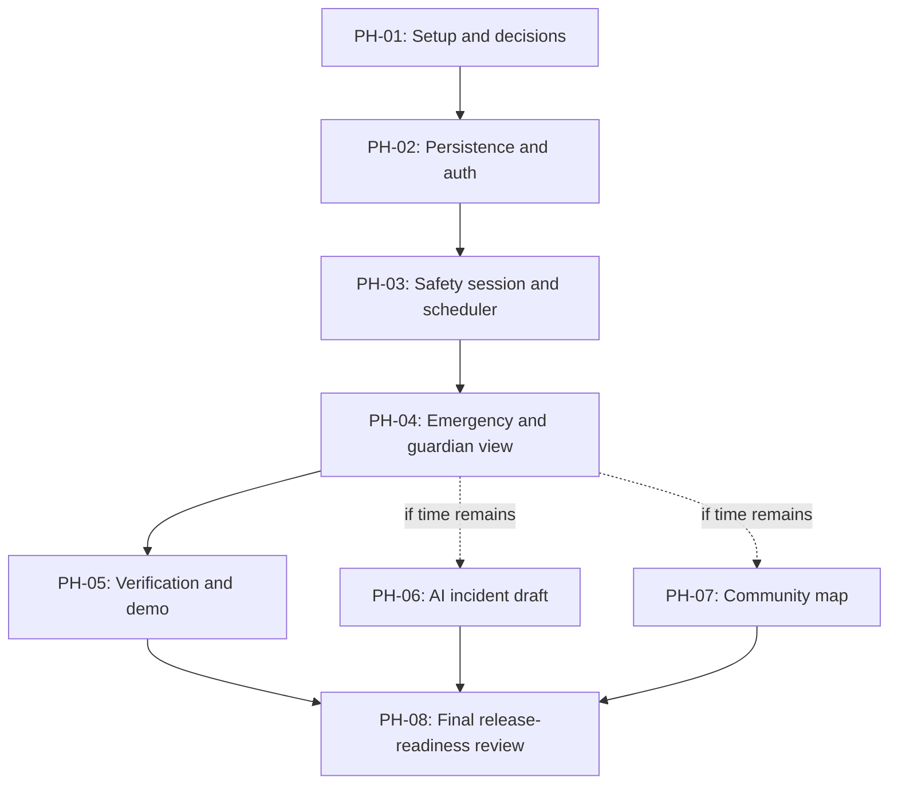

# AMANAH AI — Implementation Phases and Roadmap

**Status:** Proposed roadmap — no tasks have been executed or verified  
**Version:** 0.1  
**Planning constraint:** Three-hour hackathon MVP with AI coding assistant  
**Related:** All seven core documents

## 1. Planning principles

- This is a proposed plan, not authorization to code.
- Build and verify the core safety workflow before optional features.
- Keep the confirmed local-first constraints.
- Do not implement unapproved technologies or unresolved safety policies.
- The three-hour target is aggressive and depends on a prepared environment, available credentials, fast AI-assisted iteration, and limited integration surprises.
- If time runs short, defer P1 features rather than weakening emergency correctness or testing.

## 2. Dependency overview

PH-06 and PH-07 are optional and must not delay a verified P0 demonstration.

## 3. Phase plan

### PH-01 — Scope confirmation and project setup

**Objective:** Confirm blocking technical choices and create a runnable local skeleton.  
**Requirements:** Enabling work for FR-001, FR-003–FR-013 and NFR-005, NFR-008.  
**Deliverables:** Approved stack decisions, backend/frontend skeleton if approved, local run instructions.

Tasks:
- **TASK-001:** Review and approve/reject proposed frontend, ORM, authentication, scheduler, API, and notification choices.
- **TASK-002:** Confirm local development prerequisites and runtime versions.
- **TASK-003:** Create the approved project structure and configuration templates.
- **TASK-004:** Establish local backend startup and a minimal health check if approved.
- **TASK-005:** Establish frontend-to-backend connectivity if a separate frontend is approved.

**Exit criteria:** Both approved app processes start locally; configuration contains placeholders only; no secrets are committed.

**Testing gate:** Verify startup and frontend/backend connection. Unit/integration tests may be proportionate smoke checks at this stage.

### PH-02 — Database foundation and access control

**Objective:** Persist the minimum records and separate user/guardian access.  
**Requirements:** FR-011, FR-014 (if guardian setup included), NFR-002, NFR-003, NFR-004.  
**Deliverables:** Approved minimal schema, database initialization/migration, authenticated roles or controlled demo accounts.

Tasks:
- **TASK-006:** Implement approved user/account representation.
- **TASK-007:** Implement secure password handling and approved authentication flow.
- **TASK-008:** Implement guardian relationship/authorization representation.
- **TASK-009:** Create approved SQLite tables and migration/initialization mechanism.
- **TASK-010:** Add authorization checks for private user and guardian resources.

**Exit criteria:** Data persists across backend restart; guardian cannot access unrelated users' data; no plaintext passwords.

**Testing gate:** Unit tests for authentication/authorization; integration tests for database persistence and access denial; regression of startup and API behavior.

### PH-03 — Manual safety session and persistent scheduler

**Objective:** Implement the core manual session and anchored check-in timing.  
**Requirements:** FR-001, FR-003–FR-006, FR-008, FR-024, NFR-001, NFR-005, NFR-010.  
**Deliverables:** Session lifecycle, persisted checks, scheduler recovery behavior.

Tasks:
- **TASK-011:** Implement manual session creation and persistence.
- **TASK-012:** Implement anchored schedule calculation: +5 minutes, then every 3 minutes.
- **TASK-013:** Persist check deadlines and 60-second response deadlines.
- **TASK-014:** Implement YES response and continued monitoring.
- **TASK-015:** Implement scheduler due-event processing and duplicate-processing protection.
- **TASK-016:** Implement startup reconciliation for overdue events according to the approved downtime policy.

**Exit criteria:** Check deadlines are correct; YES does not reset the anchored cadence; deadlines survive restart; duplicate scheduler ticks do not create duplicate check events.

**Testing gate:** Unit tests for time calculations and state transitions; integration tests with SQLite; recovery and duplicate-processing tests; regression of PH-02.

### PH-04 — Emergency engine and guardian demonstration

**Objective:** Complete the main end-to-end safety workflow.  
**Requirements:** FR-007–FR-013, FR-009–FR-011, FR-025; NFR-002, NFR-006, NFR-007.  
**Deliverables:** SOS/NO/missed-check emergency processing, in-app guardian alert, same-device guardian view, deliberate resolution flow.

Tasks:
- **TASK-017:** Implement immediate NO and SOS transitions.
- **TASK-018:** Implement missed-check escalation after the 60-second response window.
- **TASK-019:** Update the same active emergency for further missed checks and create another notification attempt.
- **TASK-020:** Implement persisted in-app guardian notification/alert state.
- **TASK-021:** Build guardian dashboard with server-enforced authorization.
- **TASK-022:** Implement latest available location display only if location permission/capture is included and tested.
- **TASK-023:** Implement deliberate emergency cancellation and guardian resolution update.

**Exit criteria:** Demonstrate start → check → missed response or SOS → guardian alert → cancellation/resolution. The interface clearly distinguishes local demo alert from remote delivery.

**Testing gate:** Unit tests for emergency transitions; integration tests across scheduler, SQLite, notification records, and guardian APIs; end-to-end manual/automated flow; authorization and failure-path regression.

### PH-05 — Core MVP verification and demo readiness

**Objective:** Stabilize and demonstrate P0 functionality before optional features.  
**Requirements:** All P0 requirements; NFR-001 through relevant NFR-010.  
**Deliverables:** Verified demo script, known-limitations list, local run guide.

Tasks:
- **TASK-024:** Run complete manual-session and emergency scenarios.
- **TASK-025:** Test YES, NO, SOS, timeout, repeated missed checks, cancellation, and restart recovery.
- **TASK-026:** Test location denied/unavailable and backend/network failure behavior.
- **TASK-027:** Verify same-device logout/login and guardian access restrictions.
- **TASK-028:** Fix in-scope defects and update docs.
- **TASK-029:** Prepare a demo script that does not claim real police dispatch or guaranteed background protection.

**Exit criteria:** P0 flow works repeatably; critical defects are fixed or explicitly disclosed; test evidence is recorded.

**Testing gate:** Unit, integration, regression, and end-to-end checks relevant to the completed system; security/accessibility review; record actual commands and outcomes.

### PH-06 — Optional AI-assisted incident report

**Objective:** Add a user-reviewed AI report draft only if P0 is stable and time remains.  
**Requirements:** FR-017, FR-018, FR-024; relevant privacy NFRs.  
**Deliverables:** Manual report editor, Gemini draft integration, explicit review/approval.

Tasks:
- **TASK-030:** Confirm Gemini API/model and data-minimization approach.
- **TASK-031:** Implement manual incident report draft.
- **TASK-032:** Integrate Gemini as an optional drafting helper.
- **TASK-033:** Require user review/approval before report submission.
- **TASK-034:** Test Gemini failure and verify emergency flow is unaffected.

**Exit criteria:** AI output is clearly labelled, editable, and never auto-submitted; manual reporting works when Gemini is unavailable.

**Testing gate:** Unit tests for report validation; integration tests for provider adapter with mocked/failure responses; regression of emergency workflow; privacy review.

### PH-07 — Optional consent-controlled community map

**Objective:** Display only approved anonymized reports or clearly labelled synthetic demo data.  
**Requirements:** FR-019–FR-021, FR-026; privacy NFRs.  
**Deliverables:** Consent flow, minimized public representation, map or non-map fallback.

Tasks:
- **TASK-035:** Confirm public location precision, publication delay, and aggregation policy.
- **TASK-036:** Implement explicit consent capture.
- **TASK-037:** Implement a separate minimized public report representation.
- **TASK-038:** Build community map using the approved map provider, or a clearly labelled fallback if not approved.
- **TASK-039:** Test consent-denied, consent-revoked, hidden/removed, and empty-map states.

**Exit criteria:** No report appears publicly without explicit consent; public view contains no precise private location or identifying details; markers are clearly described as user-reported.

**Testing gate:** Unit tests for consent/publication decisions; integration tests for public/private API separation; privacy/security regression and map failure-state review.

### PH-08 — Final verification and release-readiness review

**Objective:** Audit the delivered prototype against approved requirements and disclose limitations.  
**Requirements:** All implemented requirements and relevant NFRs.  
**Deliverables:** Final test report, updated documentation, known issues, reproducible demo instructions.

Tasks:
- **TASK-040:** Verify requirement-to-feature traceability.
- **TASK-041:** Run full unit test suite.
- **TASK-042:** Run integration tests for real module/API/database boundaries.
- **TASK-043:** Run regression and end-to-end demo scenarios.
- **TASK-044:** Review authorization, consent, sensitive-data handling, accessibility, error states, and failure modes.
- **TASK-045:** Verify setup instructions on a clean local run where practical.
- **TASK-046:** Update documentation and record incomplete work and limitations.

**Exit criteria:** No unreported critical defects; all claims match observed behavior; known limitations are visible; test outcomes are recorded.

**Testing gate:** Final unit, integration, regression, and end-to-end verification. Do not describe the prototype as production-ready.

## 4. Mandatory phase testing gate

At the end of each code-changing phase:
1. Run applicable unit tests.
2. Run integration tests for changed components and their actual interfaces.
3. Run regression tests for previously working behavior.
4. Verify every phase acceptance criterion.
5. Review security, accessibility, performance, and error handling relevant to the change.
6. Fix in-scope defects and rerun affected tests.
7. Update affected documentation and task status.
8. Record commands, actual results, failures, limitations, and remaining issues.

For documentation-only or planning phases, use proportionate review and consistency validation instead of meaningless code tests.

Do not begin a dependent phase until its predecessor meets exit criteria. If a test cannot run, state why and what remains unverified.

## 5. Three-hour timebox proposal

This is an aggressive planning target, not a guarantee. It assumes an AI coding assistant, prepared environment, and no major integration blockers.

| Time | Target |
|---|---|
| 0–15 min | Setup and verify local skeleton |
| 15–40 min | Minimal persistence and access control |
| 40–75 min | Session, anchored scheduler, response window |
| 75–105 min | Emergency engine and guardian view |
| 105–140 min | Core flow integration and tests |
| 140–160 min | Optional AI report OR community map (not both unless ahead) |
| 160–180 min | Regression, demo rehearsal, documentation |

If the core flow is not stable by the 140-minute mark, drop optional features and use remaining time for verification.

## 6. Blockers before implementation

- Frontend framework and styling choice.
- Authentication method.
- Scheduler implementation and downtime recovery policy.
- In-app notification behavior and whether external email is in scope.
- Exact MVP guardian onboarding/account setup.
- Late YES behavior after guardian alert.
- Session end/expiration rules.
- Location capture frequency and display rules.
- Whether Gemini and map integrations are available/configured.
- Confirmation that demo data is synthetic and that no real police dispatch is claimed.

## 7. Task status convention

Use `Not started`, `In progress`, `Blocked`, `Implemented — unverified`, and `Verified`. A task may be marked Verified only when its acceptance criteria and applicable tests have actual evidence.
